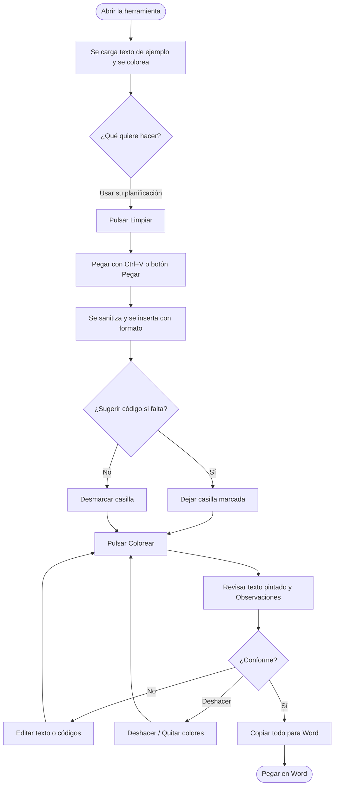
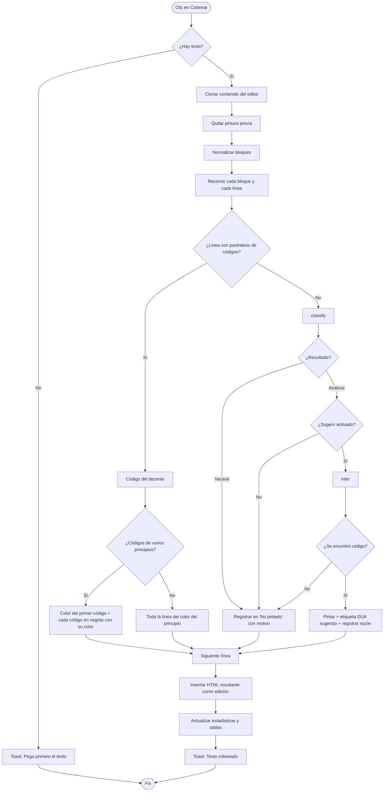
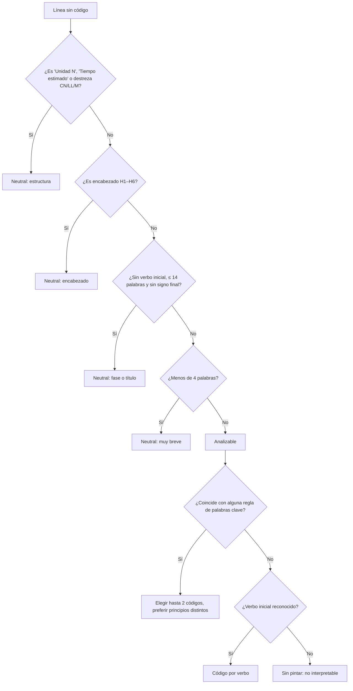
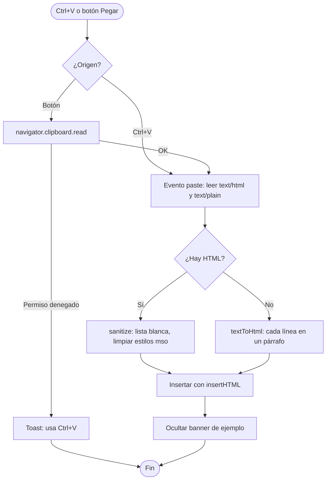
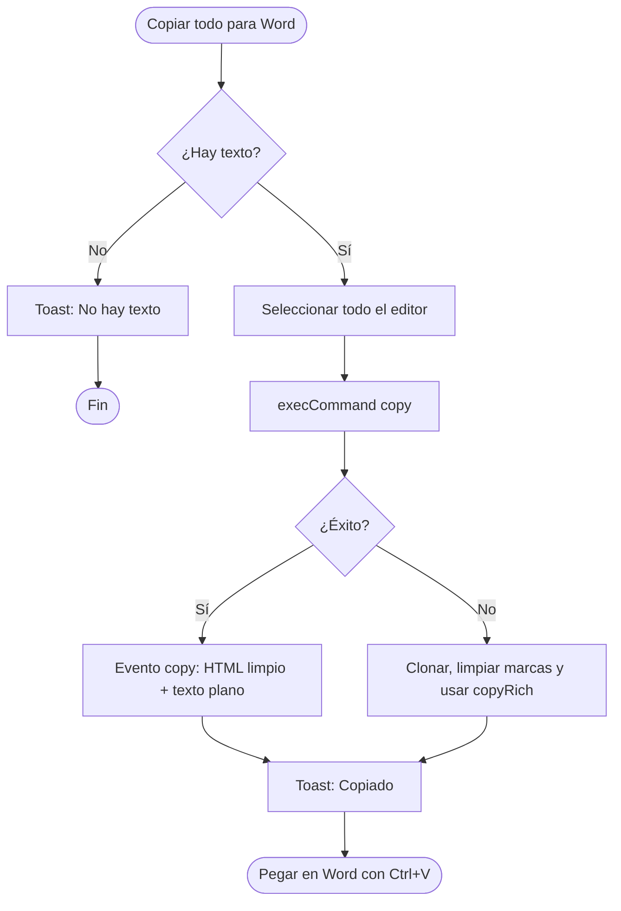

# 4. App Flow — Flujo de la Aplicación

**Producto:** Coloreador DUA 2.2

> Los diagramas usan **Mermaid**, que GitHub renderiza automáticamente en archivos `.md`.

---

## 1. Flujo principal del usuario

## 2. Flujo de «Colorear»

## 3. Árbol de decisión de clasificación

## 4. Flujo de pegado

## 5. Flujo de copiado a Word

## 6. Estados de la pantalla

| Estado | Editor | Observaciones | Botones activos |
|--------|--------|---------------|-----------------|
| Inicial | Texto de ejemplo coloreado | Estadísticas del ejemplo | Todos |
| Vacío (tras Limpiar) | Placeholder | Estadísticas en 0 | Todos |
| Con texto sin colorear | Texto pegado | Sin cambios | Todos |
| Coloreado | Texto pintado + etiquetas | Estadísticas y tablas | Todos |
| Colores quitados | Texto sin pintura | Estadísticas en 0 | Todos |

## 7. Mapa de acciones

| Acción | Atajo | Resultado |
|--------|-------|-----------|
| Cortar | `Ctrl+X` | Copia limpia y elimina selección |
| Copiar | `Ctrl+C` | HTML limpio + texto plano |
| Pegar | `Ctrl+V` | Pegado con formato sanitizado |
| Deshacer | `Ctrl+Z` | Revierte la última edición (incluye colorear) |
| Rehacer | `Ctrl+Y` | Reaplica la edición |
| Seleccionar todo | `Ctrl+A` | Selecciona el contenido del editor |
| Limpiar | — | Vacía editor y observaciones |
| Colorear | — | Pinta y genera observaciones |
| Quitar colores | — | Elimina pintura y sugerencias |
| Copiar todo para Word | — | Copia el documento completo |
| Copiar tabla para Word | — | Copia la tabla de observaciones |
