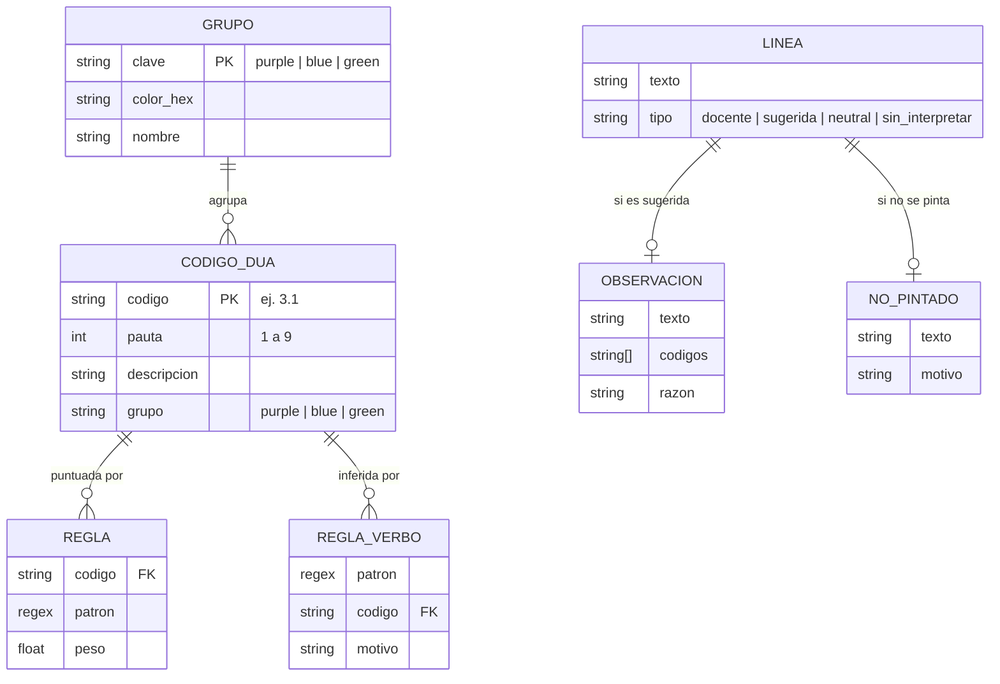

# 5. Backend Schema — Esquema de Datos

**Producto:** Coloreador DUA 2.2

---

## 1. Resumen

Coloreador DUA 2.2 **no tiene backend ni base de datos**. Toda la lógica y los datos se ejecutan en el navegador y no se persiste nada. Este documento describe, en lugar de un esquema de servidor, el **modelo de datos del lado del cliente**: constantes, estructuras de reglas, objetos de resultado y marcado del DOM.

| Aspecto | Estado |
|---------|--------|
| Servidor / API | No existe |
| Base de datos | No existe |
| Autenticación | No aplica |
| `localStorage` / cookies | No se usan |
| Red | Solo carga la fuente de Google Fonts |

## 2. Diagrama de datos (cliente)



## 3. Constantes y catálogos

### 3.1 `COLORS` — color por grupo

```js
const COLORS = { purple: "#725196", blue: "#1A7CBB", green: "#128A43" };
```

### 3.2 `NAMES` — nombre del principio

```js
const NAMES = { purple: "Representación", blue: "Acción y expresión", green: "Compromiso" };
```

### 3.3 `MAXPT` — máximo de puntos de verificación por pauta

```js
const MAXPT = { 1:3, 2:5, 3:4, 4:2, 5:3, 6:4, 7:3, 8:4, 9:3 };
```

Un código `P.V` es válido si `1 ≤ V ≤ MAXPT[P]`.

### 3.4 `DESC` — descripción por código

Clave: código `"P.V"`. Valor: texto descriptivo. Total: **29 códigos** (`1.1` … `9.3`).

### 3.5 Función de grupo

```js
groupOf(código) → "purple" (1–3) | "blue" (4–6) | "green" (7–9)
```

## 4. Estructuras de reglas

### 4.1 `RULES` — palabras clave ponderadas

```js
// [código, expresión regular, peso]
["3.3", /mapa (conceptual|mental)|organizador|…/i, 2.5]
```

| Campo | Tipo | Descripción |
|-------|------|-------------|
| `[0]` código | `string` | Código DUA que se sugiere |
| `[1]` patrón | `RegExp` | Palabras o frases que lo activan |
| `[2]` peso | `number` | Prioridad (mayor = más específico) |

### 4.2 `VERBCLS` — respaldo por verbo inicial

```js
// [expresión regular, código, motivo]
[/^[\s\d.\-–•·)]*(identificar|reconocer|…)/i, "3.2", "identifica rasgos e ideas clave"]
```

### 4.3 `STRUCT` — estructura que no se pinta

```js
// [expresión regular, motivo]
[/^\s*Unidad\s+\d+/i, "Título de unidad: identifica la unidad…"]
```

## 5. Objetos de resultado

### 5.1 Resultado de `classify()`

```ts
{ kind: "neutral", why: string } | { kind: "analizar" }
```

### 5.2 Resultado de `infer()`

```ts
{ codes: string[], reason: string } | null
```

### 5.3 Resultado de `run()`

```ts
{
  st: {
    docente: number,    // líneas con código del docente
    mixtas: number,     // líneas que combinan principios
    sugeridas: number,  // líneas interpretadas por el DUA
    sinPintar: number,  // líneas no pintadas
    warn: string[]      // avisos de códigos inexistentes
  },
  obs:     { text: string, codes: string[], reason: string }[],
  skipped: { text: string, why: string }[]
}
```

### 5.4 Rango de pintado (interno)

```ts
{ s: number, e: number, color: string, bold: boolean }
```
`s` y `e` son desplazamientos de carácter dentro del bloque.

## 6. Marcado del DOM

| Atributo | Elemento | Significado |
|----------|----------|-------------|
| `data-dua="1"` | `<span>` | Texto pintado por la herramienta |
| `data-dua-sug="1"` | `<span>` | Etiqueta `[DUA sugerido: …]` |

Estos atributos se **eliminan** al copiar/cortar para que Word reciba HTML limpio.

## 7. Expresiones regulares clave

| Nombre | Propósito |
|--------|-----------|
| `CODE` = `[1-9]\.\d{1,2}` | Un código DUA |
| `pureRe` | Paréntesis que contienen **solo** códigos (con prefijo `DUA:` opcional y separadores `-`, `–`, `—`, `,`, `;`, `/`, `y`) |
| `codeRe` | Extraer cada código individual |
| `verbRe` | Verbo inicial en infinitivo (`-ar`, `-er`, `-ir`) |

## 8. Persistencia

| Dato | ¿Se guarda? | Dónde |
|------|-------------|-------|
| Texto de la planificación | No | Solo memoria del navegador (se pierde al cerrar) |
| Resultados y observaciones | No | Solo memoria |
| Preferencias (casilla, tema) | No | Tema según el sistema |

## 9. Extensión opcional futura (propuesta, no implementada)

Si en el futuro se agregara un backend para guardar planificaciones, un esquema mínimo podría ser:

```sql
-- Propuesta; no forma parte de la versión 2.2
CREATE TABLE usuarios (
  id          UUID PRIMARY KEY,
  nombre      TEXT NOT NULL,
  institucion TEXT,
  creado_en   TIMESTAMPTZ DEFAULT now()
);

CREATE TABLE planificaciones (
  id          UUID PRIMARY KEY,
  usuario_id  UUID REFERENCES usuarios(id) ON DELETE CASCADE,
  titulo      TEXT NOT NULL,
  html        TEXT NOT NULL,
  creado_en   TIMESTAMPTZ DEFAULT now(),
  actualizado TIMESTAMPTZ DEFAULT now()
);

CREATE TABLE reglas_personalizadas (
  id          UUID PRIMARY KEY,
  usuario_id  UUID REFERENCES usuarios(id) ON DELETE CASCADE,
  codigo      TEXT NOT NULL CHECK (codigo ~ '^[1-9]\.[1-5]$'),
  patron      TEXT NOT NULL,
  peso        NUMERIC(3,1) DEFAULT 2.0
);
```

> Cualquier backend futuro debería mantener el principio de privacidad: almacenar solo con consentimiento y sin enviar texto a terceros.
